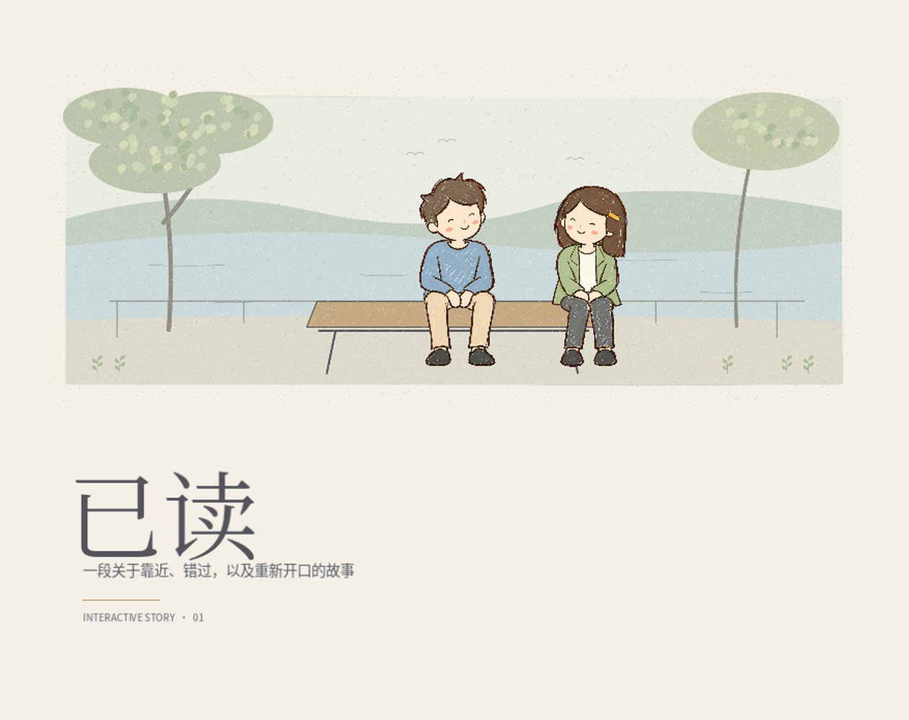
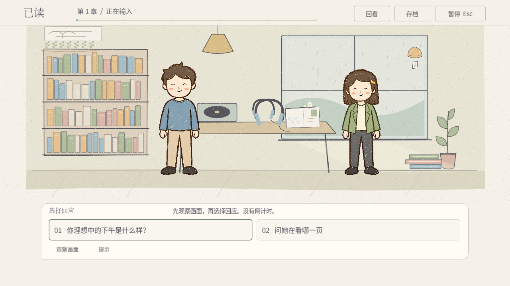
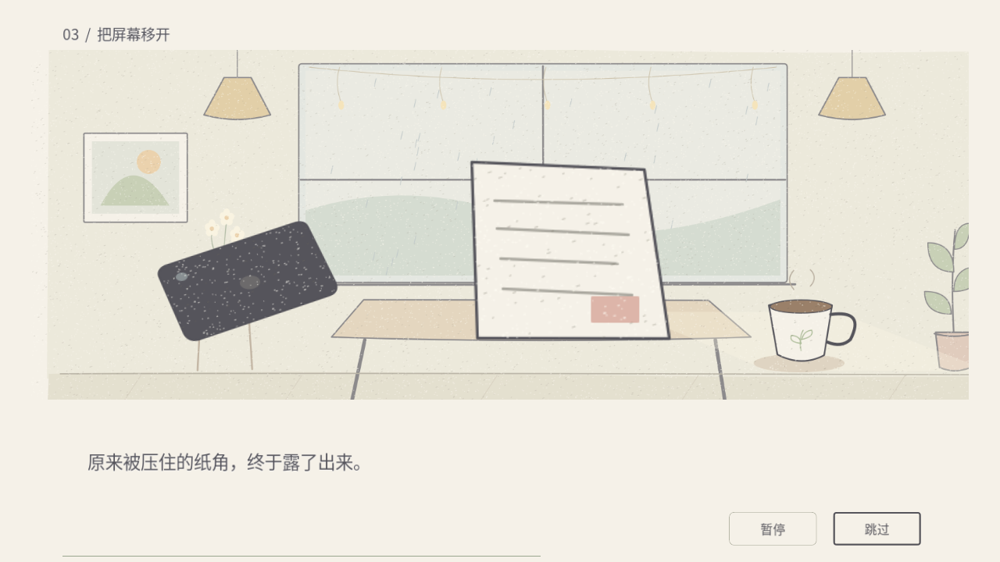

# 已读 · Yidu (v1.1.0)

> **一段需要你动手参与，而不是只替主角选台词的关系。**  
> *An interactive picture-book story about closeness, distance, and speaking again.*

  

## 立即游玩 / Play & Download

- **网页免安装即玩 (GitHub Pages)**：**[https://aircrushin.github.io/yidu/](https://aircrushin.github.io/yidu/)**
- **Windows 离线完整版 (v1.1.0)**：前往 **[Releases 页面下载 `Yidu-1.1.0-Windows.zip`](https://github.com/aircrushin/yidu/releases/tag/v1.1.0)**（解压后直接双击 `Yidu.exe`，无需安装任何运行库，无需联网）

---

## 关于《已读》

从四月的雨天书店相识，到跨城相隔后的再次选择，《已读》完整包含 **六章、18 幕、18 段分层动画过场、7 首原创合成配乐与四种结局**，并在主菜单提供独立的「第三章样章」试玩入口。

在这里，关键行动由画面里的日常物件与人物位置表达，不会全部列成文字按钮：

- **咖啡馆中**，屏幕朝上的手机正压着那张驻留通知；
- **河岸长椅上**，录音机亮着的红灯会影响她愿不愿意说出真话；
- **晚饭桌前**，移动人走过去坐下，还是移动饭碗递过去，会走向不同的回应；
- **两座城市之间**，亲手在日历上把双方都有空的夜晚拖到一起。

没有好感度分数，也没有限时倒计时。全部 18 幕的主决定都会留在本周目中，改变后续对白、桌面纪念物与结局里的六段回响，并决定隐藏第四结局「声音信」是否可达。提示分三层，先给观察方向，再按需告诉具体操作。

---

## 实机画面 / Screenshots

| 书店初遇（第 1 章） | 回声聊天界面 |
|---|---|
|  |  |

| 分层过场动画（第 3 章） | 两座城市·日程对齐（第 4 章） |
|---|---|
|  |  |

---

## 操作说明 / Controls

| 操作 | 鼠标 | 键盘 |
|---|---|---|
| 继续对白 | 点「继续」 | `Space` / `Enter` |
| 选择回应 | 点底部「选择回应」中的纸色选项 | 数字 `1–9`（含小键盘）；或 `Tab`、`Enter` |
| 补充讨论 | 点底部「补充讨论」，再选话题 | `Tab`、`Enter`；`Esc` 返回 |
| 观察物件 | 点画面中的物件 | `Tab` 到物件，`Enter` |
| 放置物件 | 拖到目标；或先点物件观察、再次点击拿起后点目标 | `Enter` 观察，`Shift+Enter` 拿起，`Tab` 选位置、`Enter` 放下 |
| 对齐时间 | 把时段拖到另一人的同一时段；或分别点选 | `Tab`、`Enter` |
| 回看早期消息 | 聊天框向上滚轮，或点「回看较早的消息」 | `PageUp`；或 `Tab`、`Enter` |
| 对白历史 / 存档 / 暂停 | 顶部「回看」/「存档」/「暂停」 | `H` / `F5` / `Esc` |
| 全屏切换（桌面版） | 设置面板中切换 | `F11` |

设置支持 **100% / 125% / 150% 字号缩放**、**减少动态**、**立即显示文字**，以及总音量 / 音乐 / 环境 / 物件音效独立调节。

---

## 存档与隐私

- **Windows 版存档位置**：`%APPDATA%\Yidu-1.1\`（含自动存档、3 个手动书签、设置与结局收集记录，具备 SHA-256 校验与损坏备份恢复机制）。
- **网页版存档位置**：保存在当前浏览器的本地存储（IndexedDB）中。
- **隐私承诺**：无账号、无广告、无遥测或数据上传，不访问通讯录、麦克风或真实日历。

---

## 制作与许可

- **引擎**：Godot Engine 4.7.2 Standard (`GL Compatibility`) — MIT License
- **字体**：Noto Sans CJK SC / Noto Serif CJK SC — SIL Open Font License 1.1
- 详细制作说明见 [`CREDITS.md`](CREDITS.md)，测试验证记录见 [`TEST_REPORT.md`](TEST_REPORT.md)，随附开源许可证见 [`licenses/`](licenses/)。
